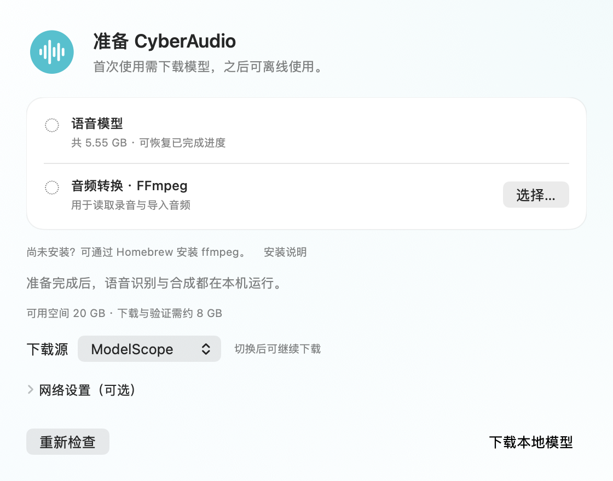
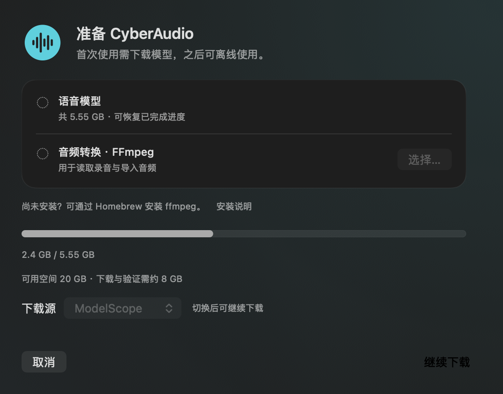

# ModelScope 固定下载源与完整目标机验收

2026-11-07，从 `main@90cea12` 继续。首次准备界面和 Assets CLI 增加显式 ModelScope 选择，默认仍为 Hugging Face。模型清单、原 Hugging Face revision、推理实现和采样参数保持原值；原审查问题仍为已修复的十五项，本功能不追加问题计数。

本阶段通过了公网续传后的完整 23 文件验证，以及使用这些文件的新目录实际 App 验收。此次复用了此前公网下载的 14 个最终文件和 176MiB 分段；没有从原模型目录复制权重，不是一次清空缓存后的重新传输。FFmpeg 使用目标机已有安装。

## 结果

| 检查 | 终态与范围 |
|---|---|
| 固定快照 | ModelScope 两个固定仓库快照包含全部 23 个原始路径，大小／SHA-256 与未修改的 Models.lock.json 一致 |
| 原生持续传输资格 | 0／45／90／135 秒开始的四段 8MiB Range 全部通过默认 TLS、206、Content-Range、长度和 SHA；有效传输合计 5.862 秒、5,724,332 bytes/s，高于预定 1,205,796 bytes/s 条件 |
| 实际 Assets 续传 | 仅调用一次当前源码签名工具，显式 `--source modelscope`，未设置代理或 SSH 网络转发；237.825 秒、exit 0、最终 `verified`，补齐剩余 2,893,911,383 字节后全部 23 文件／5,547,997,530 字节独立复核通过 |
| 既有数据保护 | 原 14 个最终文件的大小／mtime／SHA 保留，最终 TTS 的前 176MiB 与断点 SHA 相同；终态 `resumable_bytes=0`、无残留 partial；配置、Token 与生产实例保留 |
| 当前 App 传输 | 20,086,675 字节差量在 127.618 秒传完；最终 160 个文件／链接匹配，严格嵌套验签及 Assets prepare 通过，原冻结 App 保留 |
| M1 当前 App | 原驱动一次完整运行，169.013 秒、exit 0；原顺序 100 条语料、16 个格式请求、9 个声音、完整 PCM、三次断流恢复、更新等待、EOF、活动 TERM／KILL／重启通过；同 M1 旧报告 100／100 原始文本一致 |
| M4 新目录 | 仅链接到上述公网下载目录，原驱动一次完整运行，193.521 秒、exit 0；相同完整服务／App 流程通过，同 M4 旧报告 100／100 原始文本一致 |
| 本地代码检查 | 所有 `make check` 目标使用任务私有构建副本顺序执行：37 项原生契约／0 失败／0 跳过，44 项工具／0 失败／0 跳过，15 个实际原生渲染，以及准备、听写、更新、音频、五项 BackendLifecycle、生产 Helper／App 编译、shell／plist 检查通过 |
| 最终独立复核 | M1／M4 各重算 23 个模型文件及九个 WAV 帧／摘要，当前 App 各 160 项匹配；98 个编译源摘要、1,350 个共享构建输入、1,026 项保护 metadata 和六个冻结产物通过；无所属进程、端口或 request 目录残留 |

上述用时包含运行器检查，不能用作冷启动、纯网络吞吐、速度提升或取消延迟的对照。

## 固定来源和产品行为

| 组件 | ModelScope 仓库 | 不可变快照 |
|---|---|---|
| ASR | `mlx-community/Qwen3-ASR-1.7B-8bit` | `579e237ce6ec925252973afe835d2f98a138602f` |
| TTS | `mlx-community/Qwen3-TTS-12Hz-1.7B-CustomVoice-8bit` | `08b854525817066e04ef6b6430a3faa0eebd24d2` |

下载源只允许 `huggingface` 和 `modelscope`，不接受任意 URL。App 在一次尝试开始时捕获下载源与去除首尾空白的代理，运行中禁用选择；选项不写入服务配置。两路继续共用 SHA 命名分段、排他锁、Range 校验、重试、取消和最终原子发布，失败由用户决定是否换源，不自动回退。

实际 CLI 的两个有效源均到达指定本地拒绝代理并发送预期 CONNECT；三个非法值返回 `invalid_source`。控制器和 CLI 的旧行为红测均保留。正常 TLS 的直连 ModelScope 先通过配置与 1MiB 实际字节，再通过预先固定的持续资格计划，才启动一次完整续传和一次新目录推理；没有用单次成功探针直接接受完整门槛。

## 证据文件

| 文件 | 用途 |
|---|---|
| [source-manifest.json](source-manifest.json)、[snapshots.json](snapshots.json) | 模型原锁摘要、23 文件、两个快照、编译源、最终 App／驱动与目标差量传输清单 |
| [preflight.json](preflight.json)、[download-protocol.json](download-protocol.json)、[download.json](download.json) | 直接原生探针、预定资格与一次完整续传终态；最终分段状态使用 status_after，忽略最后一次进度快照的旧值 |
| [acceptance-protocol.json](acceptance-protocol.json)、[acceptance-m1.json](acceptance-m1.json)、[acceptance-m4.json](acceptance-m4.json) | 固定 100 条／单次运行协议、设备和完整流程终态；不包含原始语料转写 |
| [verification-local.json](verification-local.json)、[verification-m4.json](verification-m4.json) | 只读独立重算、同设备原始文本一致、文件保护及清理结论 |
| [checks.json](checks.json)、[review.json](review.json) | 红绿测试、构建／回归／渲染及顺序审查；无未解决的本功能代码发现 |
| [original-receipts.json](original-receipts.json)、[scripts/](scripts/) | 私有原始回执摘要与当时的完整探针／监督／复核源码；脚本保留原任务目录布局，重放前需审阅并指定隔离目录 |

首次原生构建因复制的 PCM 缓存仍引用旧 module-cache 路径而失败。只归档任务私有缓存后，完整构建／37 项契约在 386.13 秒通过；原共享缓存未改动。该失败与两个行为红测分别记录，未当作产品回归或删除历史失败。

浅色 ModelScope 选择和深色下载中状态均为 560 × 440 pt 原生离屏渲染：

## 保留的验收边界

ModelScope 的实际续传和新目录推理通过，不说明原 Hugging Face 传输已经修复，也不覆盖全新空缓存、完整 SOCKS5 大文件或 FFmpeg 从零安装。公网可用性与速度会变化。

此前短句 TTS 候选仍因固定种子 117 输出 29.2 秒未通过 ≤15 秒条件，本阶段未再运行该实验或原 7200 秒严格 M4 负载。自然混说、英文数字、九音色人耳试听、物理麦克风／真实听写／睡眠恢复、Developer ID 公证及实际 Sparkle GUI 升级和权限保留仍待完成。

当前 App 仅为独立 bundle ID 的 ad-hoc 验收副本。没有替换已安装 App、冻结 DMG、稳定版 feed 或发布资产；生产实例、配置、Token 及其摘要、内部主机名、原始转写和大型模型／二进制仅留本地私有记录。整体完善目标继续进行。
